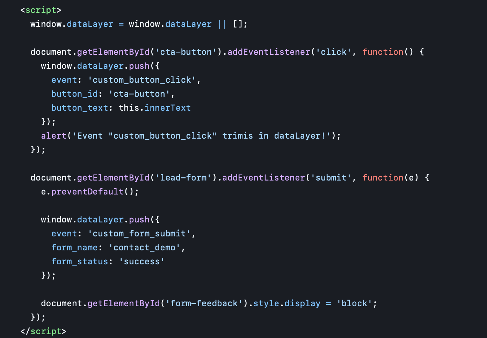
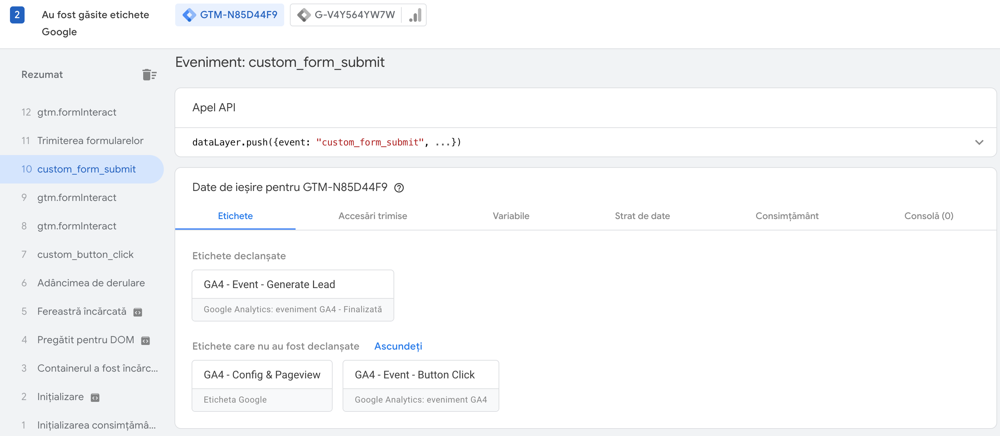
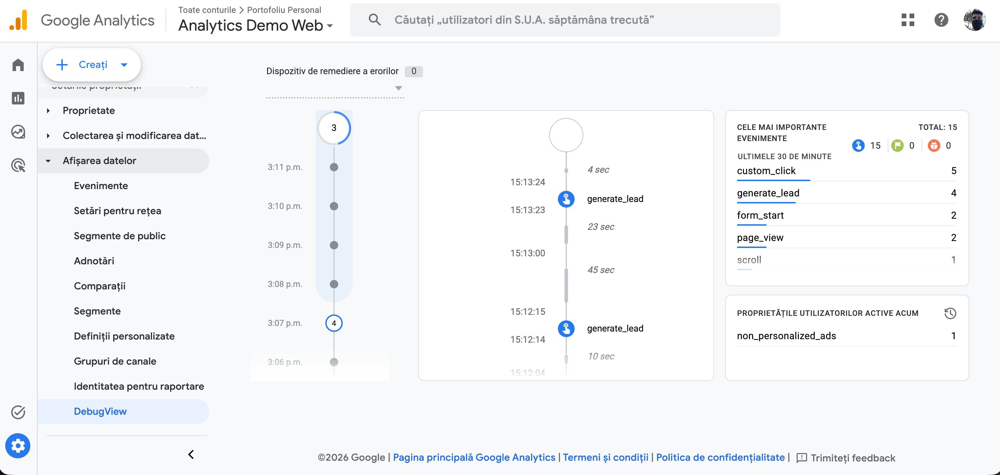
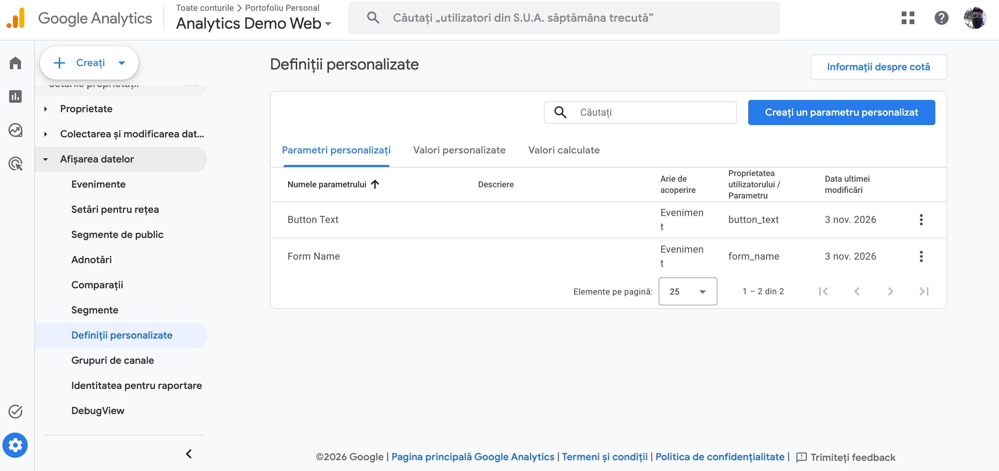

Analytics Implementation Demo (GTM & GA4)

Proiect practic end-to-end pentru implementarea, colectarea si validarea evenimentelor personalizate de analytics pe un site web utilizand Google Tag Manager si Google Analytics 4.

--------------------------------------------------

1. Implementare DataLayer (Client-Side)
Capturarea interactiunilor utilizatorului (click CTA si trimitere formular) prin intermediul obiectului window.dataLayer:

--------------------------------------------------

2. Validare Declarare Eticheta (Google Tag Assistant)
Verificarea rularii corecte a etichetei GA4 - Event - Generate Lead pe baza evenimentului custom_form_submit:

--------------------------------------------------

3. Validare In Timp Real (GA4 DebugView)
Receptionarea evenimentelor generate_lead si custom_click in consola Google Analytics 4:

--------------------------------------------------

4. Inregistrare Definitii Personalizate (Custom Dimensions)
Maparea parametrilor de eveniment button_text si form_name ca dimensiuni personalizate in GA4 pentru rapoarte de business:

